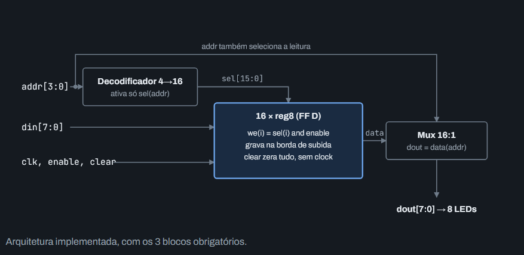
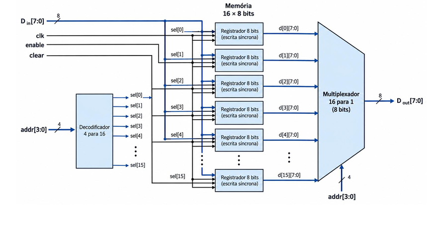

# 💾 Memória RAM 16×8 em VHDL

Memória RAM de 16 posições × 8 bits (128 bits) com **escrita síncrona** (borda de subida do clock manual) e **leitura assíncrona**, com `enable` e `clear`. Descrita em VHDL sintetizável, simulada no GHDL e prototipada em FPGA (Boolean Board).

## 🔌 Interface do top-level (`ram16x8`)

| Porta    | Direção | Largura | Função                        |
|----------|---------|---------|-------------------------------|
| `clk`    | entrada | 1 bit   | Clock manual (botão)          |
| `enable` | entrada | 1 bit   | Habilita a escrita            |
| `clear`  | entrada | 1 bit   | Zera toda a memória           |
| `addr`   | entrada | 4 bits  | Endereço de leitura e escrita |
| `din`    | entrada | 8 bits  | Dado a escrever               |
| `dout`   | saída   | 8 bits  | Dado lido (LEDs)              |

## 🧩 Arquitetura





O decodificador e o `enable` escolhem qual registrador grava. O mux, controlado pelo mesmo `addr`, escolhe qual registrador aparece em `dout`, sem esperar o clock.

## 📁 Estrutura do Projeto

```
📁 ram-16x8
├── 📁 src
│   ├── 📝 mem_pkg.vhd          # tipo mem_t (array 0 to 15 de 8 bits)
│   ├── 📝 decoder4x16.vhd      # decodificador 4→16 (combinacional)
│   ├── 📝 reg8.vhd             # registrador de 8 bits (FF D, clear assíncrono, load)
│   ├── 📝 mux16x1.vhd          # multiplexador 16:1 (combinacional)
│   └── 📝 ram16x8.vhd          # top-level estrutural
│
├── 📁 tb
│   └── 📝 tb_ram.vhd           # testbench autoverificável (TEST-01 a TEST-06)
│
├── 📁 constraints
│   └── 📝 boolean_board.xdc    # template de pinos (Vivado)
│
├── 📁 docs
│   ├── 🖼️ arquitetura.png      # arquitetura implementada
│   ├── 🖼️ diagrama-blocos.png  # diagrama de blocos detalhado
│   └── 🌐 artifact-ram16x8.html # artifact
│
├── 📝 Dockerfile               # ambiente com GHDL
├── 📝 sim.sh                   # simulação com GHDL
└── 📝 Makefile                 # simulação via make
```

Ordem de compilação: `mem_pkg` → `decoder4x16` → `reg8` → `mux16x1` → `ram16x8` → `tb_ram`.

## 📋 Requisitos

| ID | Requisito |
|----|-----------|
| REQ-01 | 16 endereços, selecionados por `addr[3:0]` |
| REQ-02 | Cada posição armazena 8 bits |
| REQ-03 | Escrita na borda de subida de `clk`, com `enable = 1` |
| REQ-04 | Com `enable = 0`, nenhuma posição é alterada |
| REQ-05 | Leitura assíncrona: `dout` muda com `addr`, sem borda de clock |
| REQ-06 | `clear = 1` zera todas as posições |
| REQ-07 | Sem escrita, os dados são mantidos |
| REQ-08 | Clock manual (botão ou switch) |
| REQ-09 | `dout` exibido nos LEDs da FPGA |
| REQ-10 | Descrição sintetizável |
| REQ-11 | Projeto contém FF D, decodificador 1:16 e multiplexador 16:1 |

## 🧠 Decisões de projeto

| ID | Decisão | Justificativa |
|----|---------|---------------|
| DEC-01 | `clear` assíncrono e prioritário sobre o clock | Zera a memória na hora. Para torná-lo síncrono, mova o `if clear` para dentro do `rising_edge`. |
| DEC-02 | `we(i) = sel(i) and enable` por posição | Só a posição endereçada recebe o dado; mantém compatibilidade com VHDL-93 (Quartus/Vivado). |
| DEC-03 | Mux puramente combinacional | Garante a leitura assíncrona (REQ-05). |
| DEC-04 | `array (0 to 15) of std_logic_vector(7 downto 0)` em pacote | Mux e top-level legíveis, sem fatiar um vetor de 128 bits. |
| DEC-05 | Top-level estrutural | Os três blocos obrigatórios (REQ-11) aparecem como componentes separados. |

> **Bounce:** um botão mecânico pode gerar várias bordas por aperto. Na escrita isso não causa erro (o mesmo dado é gravado várias vezes). Debounce é opcional.

## ▶️ Simulação

Requer [GHDL](https://github.com/ghdl/ghdl) (e opcionalmente GTKWave).

```bash
sudo apt install ghdl gtkwave
./sim.sh            # VHDL-2008
./sim.sh 93         # VHDL-93
./sim.sh 08 --wave  # abre a forma de onda no GTKWave
```

### 🐳 Via Docker (sem instalar o GHDL)

```bash
docker build -t ghdl-ram .
docker run --rm -v "$PWD":/work ghdl-ram sh -c "ghdl -a src/mem_pkg.vhd src/decoder4x16.vhd src/reg8.vhd src/mux16x1.vhd src/ram16x8.vhd tb/tb_ram.vhd && ghdl -e tb_ram && ghdl -r tb_ram --wave=onda.ghw"
gtkwave onda.ghw   # no host
```

Também funciona via `make sim` / `make wave` (`STD=93` para VHDL-93). A simulação termina sozinha em 1025 ns. Saída esperada: `RESULTADO: todos os testes passaram`.

### ✅ Plano de verificação

| ID | Teste | Procedimento | Critério |
|----|-------|--------------|----------|
| TEST-01 | Escrita | `enable = 1`, grava valor distinto nos 16 endereços | Sem erro |
| TEST-02 | Leitura | Lê os 16 endereços | `dout` igual ao gravado |
| TEST-03 | Leitura assíncrona | Troca `addr` (3, 12, 0) sem clock | `dout` muda em até 5 ns |
| TEST-04 | Enable | `enable = 0`, `din = 00`, um pulso no endereço 5 | Endereço 5 mantém o valor |
| TEST-05 | Retenção | 16 pulsos com `enable = 0` e `din = FF` | Todos mantêm os valores |
| TEST-06 | Clear | Pulso em `clear`, sem clock | Todos leem `00` |

Resultado (GHDL via Docker): 6 de 6 testes aprovados em VHDL-93 e VHDL-2008. **Teste negativo (documentado no projeto):** com o `reg8` alterado para ignorar `load`, o testbench reporta 35 falhas (TEST-02, TEST-03, TEST-04 e TEST-05), provando que detecta erros.

### 🔗 Matriz de rastreabilidade

| Requisito | Método | Simulação | FPGA |
|-----------|--------|-----------|------|
| REQ-01 | Teste | TEST-01, TEST-02 | FPGA-01, FPGA-02 |
| REQ-02 | Teste | TEST-02 | FPGA-02 |
| REQ-03 | Teste | TEST-01, TEST-02 | FPGA-01 |
| REQ-04 | Teste | TEST-04 | FPGA-04 |
| REQ-05 | Teste | TEST-03 | FPGA-03 |
| REQ-06 | Teste | TEST-06 | FPGA-05 |
| REQ-07 | Teste | TEST-05 | FPGA-06 |
| REQ-08 | Teste | n/a | FPGA-01 |
| REQ-09 | Inspeção | n/a | FPGA-02 |
| REQ-10 | Inspeção | n/a | Build sem erros |
| REQ-11 | Inspeção | Código | n/a |

## 🔬 Teste na FPGA (Boolean Board)

A Boolean Board tem 16 switches, então as 15 entradas cabem sem fios extras.

| Sinal | Periférico | Pino |
|-------|-----------|------|
| `din[7:0]` | SW0–SW7 | ver manual |
| `addr[3:0]` | SW8–SW11 | ver manual |
| `enable` | SW12 | ver manual |
| `clear` | SW13 | ver manual |
| `clk` | BTN0 | ver manual |
| `dout[7:0]` | LD0–LD7 | ver manual |

Preencha os pinos em [`constraints/boolean_board.xdc`](constraints/boolean_board.xdc). **Vivado:** botão como clock não está em pino dedicado; a linha `set_property CLOCK_DEDICATED_ROUTE FALSE [get_nets clk_IBUF]` (já incluída no template) evita falha na etapa de place.

Roteiro de laboratório (filmar cada teste como evidência):

- **FPGA-01 Escrita:** `enable = 1`. Gravar `10101010` no endereço 0, `11110000` no 5 e `00001111` no 15, apertando BTN0 em cada um.
- **FPGA-02 Leitura:** `enable = 0`. Selecionar 0, 5 e 15 e conferir os LEDs.
- **FPGA-03 Leitura assíncrona:** trocar `addr` entre 0, 5 e 15 sem apertar BTN0; os LEDs mudam na hora.
- **FPGA-04 Enable:** `enable = 0`, `din = 11111111`, endereço 5, apertar BTN0; LEDs continuam em `11110000`.
- **FPGA-05 Clear:** ligar e desligar `clear`; 0, 5 e 15 leem `00000000`.
- **FPGA-06 Retenção:** repetir FPGA-01, apertar BTN0 várias vezes com `enable = 0` e reler os três endereços.

## ⚠️ Riscos

| ID | Risco | Mitigação |
|----|-------|-----------|
| R-01 | Build falha no lab e falta tempo | Chegar com tudo simulado e pinos prontos; sexta (23/10) como reserva |
| R-02 | Vivado recusa o botão como clock | `CLOCK_DEDICATED_ROUTE FALSE` no `.xdc` |
| R-03 | Bounce gera várias bordas | Sem impacto na escrita; debounce opcional |
| R-04 | Demonstração falha na apresentação | Vídeos dos testes FPGA-01 a FPGA-06 nos slides |
| R-05 | Professor não aceitar o GHDL | Código idêntico em qualquer simulador |

## 💡 Notas de projeto

- **Por que não block RAM?** A leitura assíncrona (REQ-05) e o clear de todas as posições ao mesmo tempo (REQ-06) não cabem no modelo de block RAM. A memória vira 128 flip-flops (16 × `reg8`).
- **Sem latch inferido:** o decodificador atribui `sel <= (others => '0')` antes de ligar a saída escolhida.
- **Conversão de endereço:** `to_integer(unsigned(addr))`; `unsigned`, pois endereço não tem sinal.
